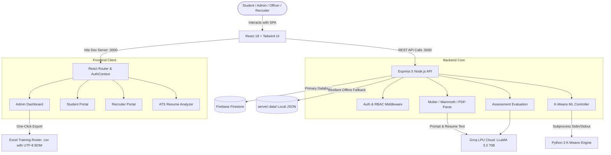

# 🎓 AI-Powered Student Placement & Readiness Intelligence Platform

> An enterprise-grade, machine-learning-driven Campus Placement & Student Readiness Management System. Seamlessly integrates **Unsupervised K-Means Clustering (Python 3)**, **Generative AI (Groq LLM)**, and **Multi-Pillar Skill Assessments** to evaluate, train, and place students into high-growth corporate careers.

---

## 📌 Table of Contents
1. [Executive Summary & Problem Statement](#-executive-summary--problem-statement)
2. [Complete Technology Stack](#-complete-technology-stack)
3. [System Architecture & Data Flow](#-system-architecture--data-flow)
4. [Core Modules & Capabilities](#-core-modules--capabilities)
5. [Machine Learning Engine: K-Means Clustering Deep Dive](#-machine-learning-engine-k-means-clustering-deep-dive)
6. [Generative AI & LLM Integrations](#-generative-ai--llm-integrations)
7. [Role-Based Access Control (RBAC)](#-role-based-access-control-rbac)
8. [Installation & Setup Guide](#-installation--setup-guide)
9. [Presentation & Viva Talking Points](#-presentation--viva-talking-points)

---

## 🎯 Executive Summary & Problem Statement

### The Problem
Traditional college placement management relies on static CGPA cutoffs and manual spreadsheets. This approach fails because:
- **CGPA is not an indicator of real-world skills:** A student with an 8.5 CGPA may struggle in live coding or behavioral rounds, while a 7.0 CGPA student might be an exceptional coder.
- **One-size-fits-all training fails:** Training hundreds of students on the same curriculum wastes college resources and leaves critical student weaknesses unaddressed.
- **Lack of ATS alignment:** Students apply to top companies with resumes that fail modern Applicant Tracking Systems (ATS) keyword and formatting parsers.

### The Solution
This platform introduces an **AI-driven, data-validated placement ecosystem**:
1. **Multi-Pillar Assessments:** Evaluates students across **Technical Coding (DSA)**, **Timed Quantitative Aptitude**, and **Verbal Communication**.
2. **K-Means Machine Learning Engine:** Partitions students into **8 distinct strength & development clusters** using unsupervised machine learning.
3. **Automated Training Rosters:** Generates downloadable Excel training schedules directly mapping each group to dedicated intervention curricula.
4. **AI ATS Resume Analyzer:** Inspects student resumes against job descriptions, identifying keyword gaps, formatting penalties, and metric scores.
5. **End-to-End Corporate Pipeline:** Enables recruiters to post campus drives, officers to nominate qualified candidates, and administrators to track placement metrics in real time.

---

## 🛠 Complete Technology Stack

| Layer / Domain | Technology | Version | Purpose in this Project |
| :--- | :--- | :--- | :--- |
| **Frontend Framework** | **React.js** | 18.3.1 | Single-Page Application (SPA) architecture, interactive reactive state management, and component modularity. |
| **Build Tool & Bundler** | **Vite** | 5.4.2 | Ultra-fast HMR (Hot Module Replacement), optimized production asset chunking, and modern ES module builds. |
| **Styling & Design System** | **Tailwind CSS** | 3.4.10 | Utility-first responsive dark-mode styling, glassmorphism UI, typography, and micro-animations. |
| **Iconography** | **Lucide React** | 0.446.0 | Modern, lightweight iconography across all dashboards, modals, and status badges. |
| **Client Document Export** | **jsPDF & html2canvas** | 2.5.1 / 1.4.1 | Client-side vector PDF generation for ATS audit reports and student resumes. |
| **Backend Runtime** | **Node.js** | v18+ / v20+ | Asynchronous event-driven server runtime handling concurrent API requests. |
| **Web API Framework** | **Express.js** | 5.2.1 | RESTful API endpoints for auth, assessment submission, clustering, and drive management. |
| **Process Orchestration** | **Concurrently** | 10.0.5 | Simultaneous execution of both backend Node server (port 5000) and Vite frontend (port 3000) via `npm run dev:all`. |
| **Machine Learning Runtime** | **Python 3** | 3.10+ | Unsupervised Machine Learning backend executing multi-dimensional K-Means clustering (`server/scripts/kmeans_clustering.py`). |
| **Generative AI / LLM** | **Groq SDK (LLaMA 3.3 70B)** | 1.6.0 | Ultra-fast LPU inference for AI resume audit, interview evaluation, and dynamic question generation. |
| **Primary Cloud Database** | **Google Firebase Firestore** | 12.19.0 / 14.4.0 | Real-time NoSQL cloud database storing student profiles, assessments, recruiter drives, and admin logs. |
| **Dual-Mode Persistence** | **Local JSON Store** | Custom | Fault-tolerant offline fallback engine (`server/.data/`) ensuring zero-config demonstration without live cloud credentials. |
| **Document Parsers** | **Mammoth & PDF-Parse** | 1.13.0 / 1.1.4 | Extracts raw text from `.docx` and `.pdf` resumes uploaded by students for ATS evaluation. |
| **File Upload Handling** | **Multer** | 2.5.0 | Multipart form-data handling for secure resume document uploads. |
| **Email Notification Engine**| **Nodemailer** | 10.1.7 | Automated transactional emails to students for drive approvals, test schedules, and placement offers. |
| **Data Export Engine** | **Native RFC-4180 CSV Engine** | Custom | Generates Excel-compatible spreadsheets with UTF-8 BOM (`\uFEFF`) for immediate Microsoft Excel opening. |

---

## 🏛 System Architecture & Data Flow



---

## 🚀 Core Modules & Capabilities

### 1. Unsupervised K-Means Machine Learning Engine
- Evaluates student performance profiles across a 4-dimensional normalized space:
  $$\mathbf{X} = [\text{Technical Score}, \text{Aptitude Score}, \text{Communication Score}, \text{Overall Readiness}]$$
- Segregates students strictly into **8 distinct strength & development cohorts**.
- Provides actionable, targeted interventions (e.g. *DSA bootcamps*, *timed speed aptitude drills*, *behavioral STAR mock interviews*).
- **One-Click Excel Export:** Instant download of all students organized by Group 1 through 8 (`.csv` formatted with UTF-8 BOM for Microsoft Excel), enabling department heads to schedule targeted training immediately.

### 2. Multi-Pillar Assessment Engine
- **Technical DSA & Language Quizzes:** Evaluates core languages (C++, Java, Python, JavaScript, Go, Rust, TypeScript, SQL) with real-time scoring and benchmark percentiles.
- **Timed Quantitative Aptitude:** Speed arithmetic, logical deduction, and spatial pattern recognition under simulated exam conditions.
- **AI Voice & Communication Evaluator:** Measures verbal articulation, tone, grammar, and delivery confidence for corporate HR interviews.

### 3. AI ATS Resume Analyzer & Auditor
- Accepts `.pdf` and `.docx` resumes.
- Extracts experience, education, skills, metrics, and project outcomes.
- Calculates an **ATS Compatibility Score (0–100%)** based on:
  - Role-specific keyword matching
  - Action verbs and quantitative impact statements (e.g., *improved latency by 30%*)
  - ATS formatting compliance (checks for tables, text boxes, and complex multi-column layouts)
- Generates a downloadable, branded PDF audit dossier.

### 4. Interactive Personalized Roadmaps
- Customized visual career roadmaps for 10+ tech specializations (Full Stack, Backend, Cloud & DevOps, Data Science, AI/ML, Cyber Security).
- Checkpoint milestones with downloadable curriculum syllabi.

### 5. Campus Recruitment & Corporate Partner Management
- Recruiters post company profiles and campus drive openings with eligibility criteria (Minimum CGPA, Minimum Overall Readiness, Eligible Branches).
- Placement officers nominate eligible students matching drive filters.
- Real-time recruitment outcome tracking (Applied, Shortlisted, Interview Scheduled, Selected / Placed).

---

## 🧠 Machine Learning Engine: K-Means Clustering Deep Dive

### Why K-Means Clustering?
Supervised learning requires historical labeled outcomes ("will place" vs "will not place"), which suffers from historical hiring bias. K-Means is **unsupervised**: it clusters students purely based on natural geometric proximity in their multi-dimensional assessment score space, uncovering true skill profiles without human bias.

### The 8 Placement Cohorts Identified

| Group # | Cohort Name | Profile Description | Targeted Training Action |
| :---: | :--- | :--- | :--- |
| **Group 1** | **Technical strong** | High coding score ($\ge 85\%$), but aptitude/communication require polish. | Daily timed speed aptitude sprints and STAR-method behavioral interview prep. |
| **Group 2** | **Communication strong** | Standout articulation ($\ge 85\%$), but coding fundamentals lag. | Intensive DSA syntax bootcamps and live code paired debugging. |
| **Group 3** | **Aptitude strong** | Outstanding quantitative reasoning ($\ge 85\%$), hands-on coding needed. | Weekly LeetCode pattern sprints (DP, Graphs) and portfolio builds. |
| **Group 4** | **Technical & Aptitude strong** | Strong engineering logic, soft skills and HR interview polish needed. | 1-on-1 mock HR interviews, executive presentation clinics, group discussions. |
| **Group 5** | **Technical & Communication strong** | High coding + articulation, timed aptitude tests indicate revision needed. | Timed arithmetic shortcut modules and speed pattern drills. |
| **Group 6** | **Communication & Aptitude strong** | Great analytical reasoning & articulation, software development guidance needed. | Core language syntax bootcamps and hands-on full stack project builds. |
| **Group 7** | **Technical, Aptitude & Communication strong** | All-round Day-1 ready performers ($\ge 80\%$ across all pillars). | Fast-track for Tier-1 dream company drives and peer mentorship roles. |
| **Group 8** | **Weak in technical, aptitude & communication** | Foundational gaps across all 3 pillars needing comprehensive remediation. | Structured coding basics, daily math reasoning, and speech confidence clinics. |

### Dual Python & Client Execution
- **Primary:** Python 3 engine executed via child process (`server/scripts/kmeans_clustering.py`), providing exact algorithmic mathematical rigor.
- **Fail-Safe Fallback:** Full client-side JavaScript K-Means engine (`src/utils/kmeansClustering.js`), guaranteeing the admin dashboard remains 100% operational even without a Python environment.

---

## 🤖 Generative AI & LLM Integrations

- **Engine:** Groq LPU (Language Processing Unit) Cloud Architecture.
- **Model:** `llama-3.3-70b-versatile` / `mixtral-8x7b-32768`.
- **Latency:** Sub-second response times ($\sim 300\text{ms}$ per request), allowing real-time resume feedback and on-the-fly assessment evaluations without UI freezes.
- **Use Cases:**
  1. *Resume Semantic Gap Analysis:* Matches candidate text against target job roles, detecting missing frameworks and technologies.
  2. *Behavioral Response Evaluation:* Rates student answers on structure, clarity, and situational maturity.

---

## 🔐 Role-Based Access Control (RBAC)

The system enforces strict permission boundaries across 4 distinct user tiers:

1. **System Administrator:**
   - Full institutional analytics & department breakdowns.
   - User and officer management (create, activate, revoke officer credentials).
   - Recruiter drive approvals and job posting governance.
   - K-Means Machine Learning Clustering and Excel training roster downloads.
2. **Placement Officer:**
   - College-wide or branch-scoped student directory management.
   - Candidate nomination for upcoming campus recruitment drives.
3. **Student Candidate:**
   - Complete personal profile, academic records, and resume upload.
   - Multi-pillar self-assessments (Technical, Aptitude, Voice Communication).
   - ATS Resume Auditor and custom career roadmaps.
   - Job drive browsing and real-time application tracking.
4. **Corporate Recruiter:**
   - Company profile registration and campus drive submissions.
   - Candidate application review and hiring status progression.

---

## 💻 Installation & Setup Guide

### 1. Prerequisites
- **Node.js:** v18.0.0 or higher
- **npm:** v9.0.0 or higher
- **Python:** v3.8+ (for Python K-Means ML script)

### 2. Clone the Repository
```bash
git clone https://github.com/Sidharth-S12/Student-Placement.git
cd Student-Placement
```

### 3. Install Dependencies
```bash
npm install
```

### 4. Environment Variables Configuration
Create a `.env` file in the root directory (or in `server/.env`):
```env
PORT=5000
VITE_API_BASE_URL=http://localhost:5000

# Optional: Groq AI API Key for real-time LLM Resume Audit & AI Voice evaluation
GROQ_API_KEY=your_groq_api_key_here

# Optional: Firebase Cloud credentials (system operates automatically in resilient offline local store if omitted)
FIREBASE_PROJECT_ID=your-project-id
FIREBASE_CLIENT_EMAIL=your-client-email
FIREBASE_PRIVATE_KEY="your-private-key"
```

### 5. Run the Platform
Start both the backend API server and the frontend Vite server concurrently with a single command:
```bash
npm run dev:all
```
- **Frontend URL:** `http://localhost:3000`
- **Backend API URL:** `http://localhost:5000`

---

## 🎤 Presentation & Viva Talking Points

When presenting this project to evaluators, professors, or recruiters, highlight these key design decisions:

1. **Why K-Means instead of simple average percentage?**
   > *"Two students can both have a 70% overall average. However, Student A might have 90% technical coding with 50% communication, while Student B has 50% technical with 90% communication. A traditional percentage treats them identically. Our K-Means clustering segregates them into Group 1 and Group 2, automatically prescribing targeted soft skills training for Student A and intensive coding bootcamps for Student B."*

2. **How does the Excel download simplify institutional administration?**
   > *"Rather than manually sorting through student test scores, the admin clicks 'Download Groups (Excel)'. The system automatically generates a formatted spreadsheet with Group 1 through 8 headers, student names, contact details, test percentiles, and exact recommended training curricula, ready to hand over directly to training faculty."*

3. **How is system resilience handled?**
   > *"The system features dual-mode architecture at two levels: First, if live Firebase cloud credentials are unavailable, it smoothly falls back to an internal JSON persistence engine (`server/.data/`). Second, if Python is unavailable, the K-Means clustering seamlessly falls back to an integrated client-side ML engine. The application never crashes during live demonstrations."*

4. **Why Groq LLM instead of standard OpenAI?**
   > *"Groq's LPU architecture achieves token generation speeds of over 300 tokens/second. This enables instant ATS resume feedback and real-time speech evaluation without the 5–10 second latency typical of traditional cloud LLMs."*

---

## 📄 License
This project is developed for academic, placement training, and institutional recruitment purposes.
Distributed under the **MIT License**.